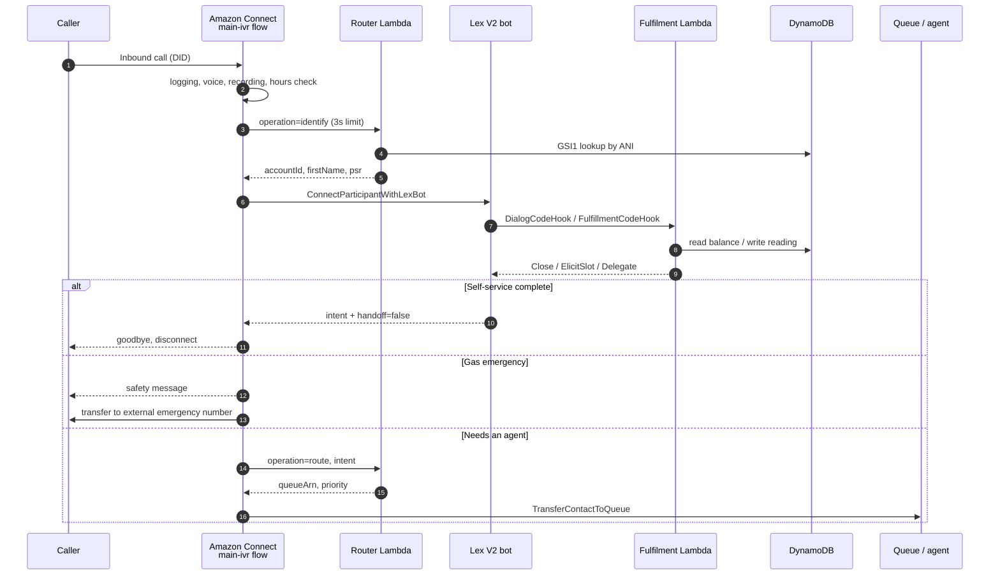
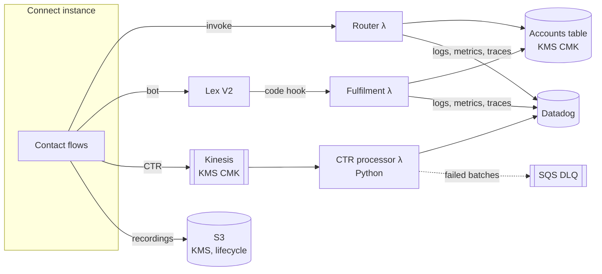

# Architecture

## Call path

Two properties matter more than the rest:

1. **The emergency path has no dependencies.** A caller who says "gas leak" goes from the Lex intent straight to a message and an external transfer. No Lambda, no DynamoDB. If either is down, that path still works. There is a test that walks the flow graph to enforce this.
2. **Every failure lands on a person.** Lambda errors, Lex timeouts, an unknown intent and a missing queue ARN all end up at the default queue. The only dead ends are "queue at capacity" and a technical error message, and both are alarmed.

## Data flow

## Deployment unit

One CDK stack per tenant per stage (`brightwell-energy-prod`, `drita-energji-dev`, …). A stack owns everything listed above, including its own Connect instance, KMS key and table. See [ADR 0002](adr/0002-instance-per-tenant.md) for why it isn't a shared instance.

Things deliberately **not** managed by the stack:

- **Phone numbers.** Claiming or porting a number is a commercial process with lead times. Numbers are associated to the flow once, out of band, and recorded in the tenant config so the router can resolve entry points.
- **Agents, routing profiles and security profiles.** These change daily and belong to workforce management, not to a deploy pipeline.
- **The Datadog API key.** Read from Secrets Manager by ARN, passed in as context.

## Lambda sizing

| Function | Timeout | Memory | Why |
|---|---|---|---|
| Router | 4s | 1024 MB | Flow gives up at 3s. The extra second means a slow call gets logged rather than vanishing. Memory buys CPU for cold start. |
| Lex fulfilment | 5s | 1024 MB | Lex hook limit is generous, but the caller isn't. Internal budget is `remaining - 300ms`. |
| CTR processor | 30s | 256 MB | Async, batched, nobody is waiting on the line. |

All on arm64. Provisioned concurrency is off by default and switched on per tenant once traffic justifies it. At low volume the cold starts it removes cost more than they're worth.
